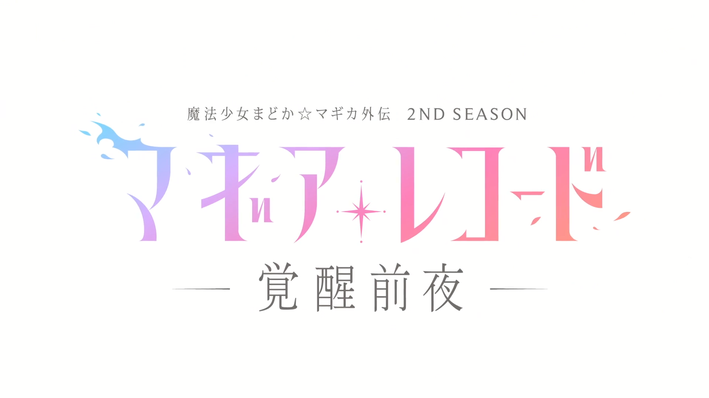

## SYNOPSIS
> In the near future, augmented reality has become a key part of daily life. A gentle middle school girl named Yuuko "Yasako" Okonogi and her family have just moved to Daikoku City despite rumors of people disappearing. There, her grandmother, nicknamed "Mega-baa," runs a shop called Megasia that specializes in illegal tools which interact with parts of the virtual world. 
Mega-baa also hosts an unofficial detective agency called Coil, a group of children around Yasako's age who find and handle corruption of the virtual world. Yasako gets involved with the group when Fumie Hashimoto, a playful member of Coil, helps rescue her cyberdog Densuke after getting trapped in virtual space while chasing a mysterious virus. Also investigating these corruptions and viruses is an abrasive hacker named Yuuko Amasawa, who the others take to calling Isako. 
Can Coil discover the truths behind the mysterious viruses and corruption, and if they can, at what cost? 
<cite>(Written by MAL Rewrite)</cite>

## Episode List
<table>
	<thead>
		<tr>
			<th scope="col">No.</th>
			<th scope="col">Title</th>
			<th scope="col">Aired</th>
		</tr>
	</thead>
	<tbody>
		<tr>
			<th>1</th>
			<td>The Children With Glasses</td>
			<td>12 May 2007</td>
		</tr>
		<tr>
			<th>2</th>
			<td>Coil Cyberinvestigation Agency</td>
			<td>19 May 2007</td>
		</tr>
		<tr>
			<th>3</th>
			<td>Yūko and Yūko</td>
			<td>26 May 2007</td>
		</tr>
		<tr>
			<th>4</th>
			<td>Daikoku City Hackers Club</td>
			<td>2 Jun 2007</td>
		</tr>
		<tr>
			<th>5</th>
			<td>Metabug Scramble Bus Tour</td>
			<td>9 Jun 2007</td>
		</tr>
		<tr>
			<th>6</th>
			<td>The Red Automaton</td>
			<td>16 Jun 2007</td>
		</tr>
		<tr>
			<th>7</th>
			<td>Move Out!! Coil Investigation Agency</td>
			<td>23 Jun 2007</td>
		</tr>
		<tr>
			<th>8</th>
			<td>The Summer Festival and the Duel</td>
			<td>30 Jun 2007</td>
		</tr>
		<tr>
			<th>9</th>
			<td>Michiko: From the Other Sideb</td>
			<td>7 Jul 2007</td>
		</tr>
		<tr>
			<th>10</th>
			<td>Kanna's Diary</td>
			<td>14 Jul 2007</td>
		</tr>
		<tr>
			<th>11</th>
			<td>Submerged in Daikoku City!</td>
			<td>21 Jul 2007</td>
		</tr>
		<tr>
			<th>12</th>
			<td>Daichi's First Hair</td>
			<td>28 Jul 2007</td>
		</tr>
		<tr>
			<th>13</th>
			<td>The Last Plesiosaur</td>
			<td>4 Aug 2007</td>
		</tr>
		<tr>
			<th>14</th>
			<td>Chronicles of a Living Creature</td>
			<td>1 Sep 2007</td>
		</tr>
		<tr>
			<th>15</th>
			<td>The Boy on the Other Side of the Station</td>
			<td>8 Sep 2007</td>
		</tr>
		<tr>
			<th>16</th>
			<td>Isako's Hospital Room</td>
			<td>15 Sep 2007</td>
		</tr>
		<tr>
			<th>17</th>
			<td>The Last Summer Vacation</td>
			<td>22 Sep 2007</td>
		</tr>
		<tr>
			<th>18</th>
			<td>The Door to Another World</td>
			<td>29 Sep 2007</td>
		</tr>
		<tr>
			<th>19</th>
			<td>The Black Visitors</td>
			<td>6 Oct 2007</td>
		</tr>
		<tr>
			<th>20</th>
			<td>Kanna and Yasako</td>
			<td>13 Oct 2007</td>
		</tr>
		<tr>
			<th>21</th>
			<td>The Black Automaton</td>
			<td>20 Oct 2007</td>
		</tr>
		<tr>
			<th>22</th>
			<td>The Last Coil</td>
			<td>27 Oct 2007</td>
		</tr>
		<tr>
			<th>23</th>
			<td>The Granted Wish</td>
			<td>10 Nov 2007</td>
		</tr>
		<tr>
			<th>24</th>
			<td>The Kids Cast Their Glasses Away</td>
			<td>17 Nov 2007</td>
		</tr>
		<tr>
			<th>25</th>
			<td>Kanazawa City Window Crossing</td>
			<td>24 Nov 2007</td>
		</tr>
		<tr>
			<th>26</th>
			<td>Yasako and Isako</td>
			<td>1 Dec 2007</td>
		</tr>
	</tbody>
</table>

## Cast
<table>
	<thead>
		<tr>
			<th scope="col">Character</th>
			<th scope="col">VA</th>
		</tr>
	</thead>
	<tbody>
		<tr>
			<td>Yuuko Okonogi (環 いろは)</td>
			<td>Fumiko Orikasa</td>
		</tr>
		<tr>
			<td>Yuuko Amasawa (七海 やちよ)</td>
			<td>Houko Kuwashima</td>
		</tr>
		<tr>
			<td>Kenichi Harakawa (由比 鶴乃)</td>
			<td>Romi Park</td>
		</tr>
		<tr>
			<td>Fumie Hashimoto (深月 フェリシア)</td>
			<td>Sachiko Kojima</td>
		</tr>
	</tbody>
</table>

## Watch Session
<table>
	<thead>
		<tr>
			<th scope="col">Date</th>
			<th scope="col">Episode(s)</th>
		</tr>
	</thead>
	<tbody>
		<tr>
			<th style="text-align: left;">27 Nov 2026</th>
			<td>1. The Children With Glasses</td>
		</tr>
	</tbody>
</table>

## ScreenCaps

