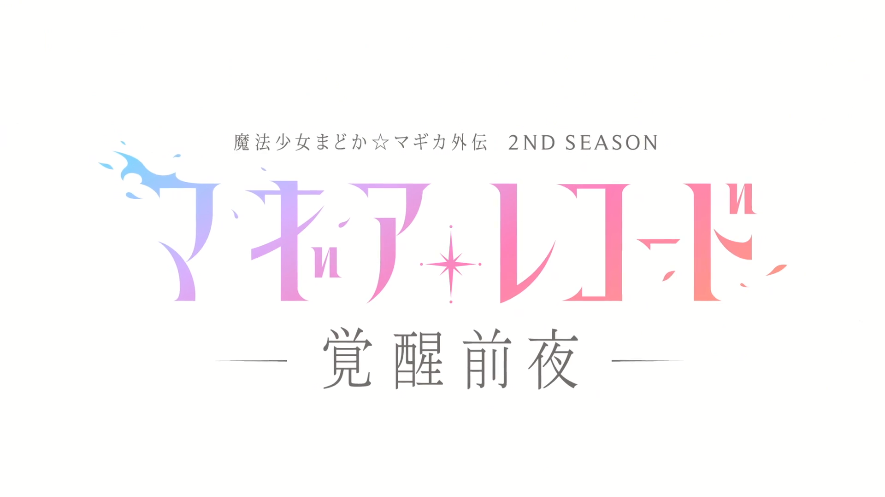

## SYNOPSIS
> After a daring escape from the Memory Museum, Sayaka Miki returns to Mitakihara City with unsettling news. Troubled by what she has learned, Sayaka reveals to Madoka Kaname and Homura Akemi the whereabouts of Mami Tomoe—but more importantly—the disturbing truth behind the existence of magical girls. Despite knowing the cruel fate that awaits them, the three quickly resolve to work together and save Mami once and for all. 
Meanwhile in Kamihama City, Yachiyo Nanami hunts various "rumors" in search of Hotel Fendt Hope, the headquarters for the Wings of Magius. The magical girl organization is Yachiyo's only lead in finding Iroha Tamaki, whose disappearance remains shrouded in uncertainty. Determined to reunite Team Mikazuki Villa, Yachiyo swears to destroy the Wings of Magius and put a stop to their insidious plans. 
Amid the turbulent situations, a calamitous threat approaches, presenting a dire conflict set to jeopardize the entire world. <cite>(Written by MAL Rewrite)</cite>

## Comment
> pink girl fumble so bad madoka and girlfailure homu is in it now

## Episode List
<table>
	<thead>
		<tr>
			<th scope="col">No.</th>
			<th scope="col">Title</th>
			<th scope="col">Aired</th>
		</tr>
	</thead>
	<tbody>
		<tr>
			<th>1</th>
			<td>I Had a Feeling We Could All Become Magical Girls Together</td>
			<td>8 Aug 2021</td>
		</tr>
		<tr>
			<th>2</th>
			<td>You're Nothing Like Me</td>
			<td>15 Aug 2021</td>
		</tr>
		<tr>
			<th>3</th>
			<td>There Were Too Many To Carry</td>
			<td>22 Aug 2021</td>
		</tr>
		<tr>
			<th>4</th>
			<td>Are You Okay With That?</td>
			<td>29 Aug 2021</td>
		</tr>
		<tr>
			<th>5</th>
			<td>I Won't Forgive Anybody</td>
			<td>5 Sep 2021</td>
		</tr>
		<tr>
			<th>6</th>
			<td>This Is Something Only I Can Do</td>
			<td>12 Sep 2021</td>
		</tr>
		<tr>
			<th>7</th>
			<td>You Don't Know Anything</td>
			<td>19 Sep 2021</td>
		</tr>
		<tr>
			<th>8</th>
			<td>You're Not Strong</td>
			<td>26 Sep 2021</td>
		</tr>
	</tbody>
</table>

## Cast
<table>
	<thead>
		<tr>
			<th scope="col">Character</th>
			<th scope="col">VA</th>
		</tr>
	</thead>
	<tbody>
		<tr>
			<td>Iroha Tamaki (環 いろは)</td>
			<td>Momo Asakura</td>
		</tr>
		<tr>
			<td>Yachiyo Nanami (七海 やちよ)</td>
			<td>Sora Amamiya</td>
		</tr>
		<tr>
			<td>Tsuruno Yui (由比 鶴乃)</td>
			<td>Shiina Natsukawa</td>
		</tr>
		<tr>
			<td>Felicia Mitsuki (深月 フェリシア)</td>
			<td>Ayane Sakura</td>
		</tr>
	</tbody>
</table>

## Watch Session
<table>
	<thead>
		<tr>
			<th scope="col">Date</th>
			<th scope="col">Episode(s)</th>
		</tr>
	</thead>
	<tbody>
		<tr>
			<th style="text-align: left;">10 Nov 2026</th>
			<td>1. I Had a Feeling We Could All Become Magical Girls Together
			 2. You're Nothing Like Me</td>
		</tr>
		<tr>
			<th style="text-align: left;">14 Nov 2026</th>
			<td>3. There Were Too Many To Carry
			 4. Are You Okay With That?</td>
		</tr>
	</tbody>
</table>

## ScreenCaps

